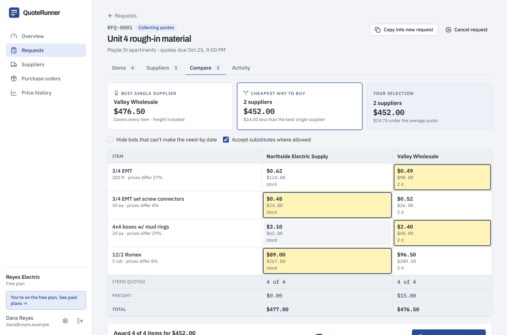

# QuoteRunner — business plan

**One line:** Send one material list to all your suppliers, get every price back on one page,
and buy the cheapest way, freight included.

## Who it is for

The first customer is the **owner, office manager or project manager at a 5–50 person
specialty contractor**: electrical, plumbing, HVAC, low-voltage, framing and drywall. Close
second: **machine and fabrication job shops** buying stock, tooling and outside services.

What they have in common:

- They buy materials for every job from 3–10 local suppliers.
- They have no purchasing department and no procurement software. Quotes arrive by phone,
  email, text and PDF, and get compared on a notepad or in Excel, or not compared at all.
- They spend roughly $300k–$10M a year on materials. For a contractor with $3M revenue,
  materials and subcontracts average about 37.6% of revenue (Statistics Canada, see
  `docs/research/ideas.md`), so roughly $1M a year goes through this process.

Not the first customer: large GCs and enterprises (Kojo, Didero, Arkestro and Keelvar sell
there), and homeowners.

## The problem

Getting three prices for one list takes a morning of calls and emails, then chasing the
supplier who has not answered. The answers come back in different formats, with different
units and freight terms, so the comparison is done in someone's head. Most of the time the
shop calls its usual supplier and pays whatever it charges.

**Hypotheses to confirm in the first 15 conversations** (do not put them in marketing until
real data backs them):

1. Line prices for the same material differ by 10% or more between local suppliers on a
   typical request.
2. A buyer spends 2+ hours a week requesting, chasing and comparing quotes.
3. Suppliers will price on a link without creating an account when the request comes from a
   customer they want to keep.

## The product (built)

| Step | What happens | Screenshot |
|---|---|---|
| Paste a list | A messy list from a text, email or takeoff becomes clean lines with quantity, unit and part number. AI reads it when a key is set; a rule-based parser works offline. | [new request](../../screenshots/quoterunner-new-request.png) |
| Send | Every supplier gets an email with the list and a personal quote link. No supplier account. | — |
| Suppliers answer their way | On the phone-friendly link, by replying to the email, or with their usual PDF. Replies and PDFs are read into a draft quote the buyer approves. Automatic reminders before the deadline. | [supplier portal](../../screenshots/quoterunner-supplier-portal-phone.png) |
| Compare | One table: every price, lead time and freight charge, the best price per line highlighted, best single supplier vs. cheapest split (freight counted once per supplier used), filters for need-by date and substitutes. | [compare](../../screenshots/quoterunner-compare.png) |
| Award | One click creates a purchase order per winning supplier, emails it, thanks the others, and records the prices. | [purchase order](../../screenshots/quoterunner-purchase-order.png) |
| Remember | Price history per item ("last paid"), supplier response times and win rates, money saved against the average quote. | [overview](../../screenshots/quoterunner-dashboard.png) |

A free, no-signup **material list cleaner** (`/tools/rfq-builder`) is the top of the funnel.

## Why this can win

| Alternative | Why a 15-person shop doesn't use it |
|---|---|
| Phone, email, Excel | Free, but slow; nobody compares properly; no record of past prices |
| Kojo | Built for commercial contractors with procurement teams; sales-led |
| Didero, Arkestro, Keelvar | Enterprise procurement, long implementations, enterprise prices |
| Generic AI procurement agents | Not built around trade line items, freight, need-by dates and supplier portals |
| ERP / construction suites (Procore, ServiceTitan, Buildertrend) | Purchasing is one tab among hundreds; too heavy or too expensive for this job alone |

QuoteRunner's edge for this buyer:

1. **Ten minutes to the first request.** Paste suppliers from a spreadsheet, paste a list,
   send. No implementation project.
2. **Suppliers need nothing.** A link, an email reply or a PDF all work. This removes the
   biggest adoption blocker in two-sided tools.
3. **It does the math people skip.** Split awards with freight counted correctly, lead times
   against the need-by date, substitutes on or off.
4. **Priced for a small shop**, with a free plan that is useful on its own.

## Pricing

| Plan | Monthly | Yearly | For | Main limits |
|---|---|---|---|---|
| Free | $0 | $0 | Trying it on real jobs | 3 requests / month, 3 suppliers per request, 10 AI reads |
| Pro | $149 | $1,490 | One buyer | Unlimited requests, 25 suppliers per request, 500 AI reads, reminders, price history, PO email, 2 seats |
| Team | $299 | $2,990 | PMs and foremen requesting too | 50 suppliers per request, 2,000 AI reads, 10 seats |

Yearly is ten months' price for twelve. A 14-day Pro trial applies when billing is on.

**Why buyers say yes to $149:** a shop buying $1M of materials a year that saves 1% saves
$10,000, against $1,788 a year for Pro. The app shows the saving on every award ("$24.75
under the average quote") and adds it up on the overview, so the ROI is visible every month,
not argued once at signup.

Pricing rules for the first 90 days:

- Don't discount the monthly price; offer the yearly plan or a longer pilot instead.
- First 10 paying customers: "founding customer" price locked for life at $99/month in exchange
  for a case study and a monthly 20-minute feedback call.
- Raise the price for new customers once there are 3 case studies with real savings numbers.

## Unit economics (estimates)

| Cost per active paying account per month | Estimate | Basis |
|---|---|---|
| Hosting | $0.10–$1 | One small server serves hundreds of accounts |
| AI | $1–$15 | Claude Opus 5.5 at $4 / $20 per million input / output tokens: reading a list costs about $0.04, reading a two-page PDF quote about $0.06. Most quotes arrive through the portal and cost nothing. |
| Email | < $1 | Transactional email at this volume |
| Payment processing | about 3% of revenue | Stripe card fees |

Expected gross margin: **85–95%**. The AI line is the only one that grows with usage; plan
limits cap it. The app defaults to Claude Opus 5.5. Setting `ANTHROPIC_MODEL=claude-sonnet-5-5`
roughly halves the AI cost, and `claude-haiku-5-5` makes it negligible. Test quote-reading
quality on real supplier PDFs before switching; which model to run is your call.

## Targets

| Milestone | Accounts | MRR |
|---|---|---|
| Day 45 | 10+ buyer conversations, 3+ accounts on real jobs | $0 |
| Day 90 | 3+ paying | $500+ |
| Month 6 | 25 paying | ~$4,000 |
| Month 12 | 70 paying (60 Pro, 10 Team) | ~$12,000 |

Funnel assumptions to measure and then replace with real numbers:

- Free tool visitor → signup: 3–5%
- Signup → activated (first request sent to 2+ suppliers within 7 days): 40%
- Activated → paid within 60 days: 15–25%

## Metrics that matter

1. **Activation:** first request sent to 2+ suppliers within 7 days of signup.
2. **Weekly requests per active account** (the habit metric).
3. **Supplier answer rate** and the share answering on the link vs. email vs. PDF.
4. **Money saved per account per month** (shown in the app; this is the retention metric).
5. **Free → paid conversion** and **logo churn**.

`GET /api/admin/stats` (for `ADMIN_EMAILS`) returns signups, plan mix, estimated MRR and AI
usage.

## Risks

| Risk | Mitigation |
|---|---|
| Suppliers ignore the link | Email reply and PDF both work; reminders; the buyer can type a phoned-in quote |
| AI misreads a price | AI-read quotes land as "needs review" and must be approved before they count |
| Buyers stay loyal to one supplier no matter what | Position as "check your usual supplier is still competitive"; show savings, not switching |
| A funded player moves downmarket | Speed of setup, price, and founder support; win the niche first (one trade, one region) |
| Price data sensitivity | Tenant isolation is tested; pricing data is never shared between companies without opt-in |

## Next features (only when pilots ask)

- QuickBooks Online / Xero: push POs and bills.
- SMS quote links for suppliers who don't read email.
- "Reorder at last price" and simple supplier catalogs.
- CSV import from estimating and takeoff tools.
- PO approvals above an amount, and multi-location companies.
- Opt-in, anonymised price benchmarks ("you paid 8% above the area median").
